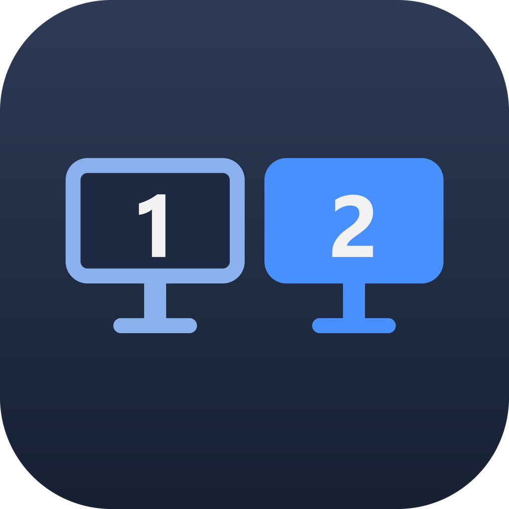

<p align="center"></p>

# Monitor Control Center

Monitor control center for Windows that **tells identical monitors apart**.

Many monitor tools address monitors by model name or list position, so two or more monitors of the
same model get mixed up (same EDID, serial and ID). Monitor Control Center identifies every physical
monitor by its Windows display number (`\\.\DISPLAYn`) and its PnP device-instance path, and sends
every DDC/CI command, resolution and rotation change to that exact monitor.

> **Tested only on Lenovo Legion monitors.** It uses standard Windows APIs and the VESA DDC/CI
> standard, so other brands should work for the standard settings (brightness, contrast, color
> preset, RGB gain, input, power). The gaming settings (Over Drive, HDR, game mode, dynamic
> contrast) use Lenovo's codes and may do something else, or nothing, on other brands.

## Features

- Map of your screens as Windows arranges them: click a screen to control it
- Brightness, contrast, color preset, RGB gain and other DDC/CI (VCP) controls per monitor
- **Follow changes**: link other monitors so changes to the selected one also go to them
- **Brightness of all** monitors with one slider
- **Turn screens on and off**: take a monitor off the Windows desktop (it stops getting a picture
  and goes to standby) and bring it back where it was; the primary screen stays on
- **Profiles**: save which screens are on (e.g. only screen 7) together with a monitor's image and
  game settings, and apply them in one click
- Resolution, refresh rate and rotation per monitor, undone automatically if not confirmed
- Per-unit EDID / serial read from each monitor's own registry instance
- "Identificar" shows the Windows display number on each screen
- Automatic updates from GitHub Releases

See [app/MECHANICS.md](app/MECHANICS.md) for how it works.

## Requirements

- Windows 10 or 11, x64
- For the DDC/CI settings: a monitor with DDC/CI turned on in its own menu, connected directly
  (some docks, USB-C hubs, DisplayLink adapters and KVMs block DDC/CI). No manufacturer driver is
  needed. Laptop built-in screens do not use DDC/CI.

## Install and updates

Download `monitor-control-center-vX.Y.Z-windows-x64.exe` from
[Releases](https://github.com/gabriel20vieira/LegionMonitorControlCenter/releases/latest) and run it.

The app checks GitHub Releases at start and every 6 hours. A newer version is downloaded in the
background and checked (size, SHA-256, Windows executable); a banner then offers
"Reiniciar e atualizar", or the update is installed when the app closes. Keep the exe in a folder
you can write to (not `Program Files`). Start it with `--no-update` to turn update checks off.

## Build

Requires Rust (stable) on Windows.

```bash
cd app
cargo build --release
```

Binary: `app/target/release/monitor-control-center.exe`.

## Releasing

1. Set the new version in `app/Cargo.toml` (and run `cargo build` to update `Cargo.lock`).
2. Commit, then push a tag with the same version: `git tag v0.3.1 && git push origin v0.3.1`.
3. The [Release workflow](.github/workflows/release.yml) builds, tests and publishes the exe to
   the GitHub release. Running apps pick it up on their next check.

## License

MIT — see [app/LICENSE](app/LICENSE).
